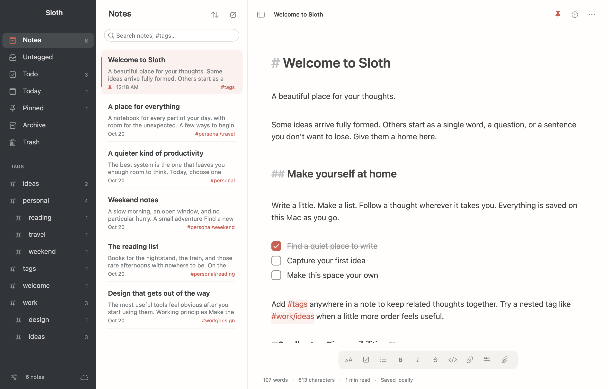

# Sloth

Sloth is a native macOS app for Markdown notes, tasks, and attachments. Built with Swift and AppKit, it keeps your notes on your Mac and offers optional iCloud Drive synchronization.



## Features

- A three-pane workspace with light and dark themes, adjustable text size, focus mode, and restored reading positions.
- Markdown editing with formatting shortcuts, clickable task checkboxes, undo/redo, and automatic list continuation.
- Inline images, file cards, and Quick Look previews. Add attachments using the paperclip, drag and drop, or paste.
- Search, inline `#tags`, nested tags such as `#work/project`, and clickable `[[wiki links]]`.
- Pinned notes, sorting, duplicate, archive, trash, and restore.
- Note statistics and a clickable heading outline.
- Markdown import and export, including referenced attachment files.
- Local saving and optional iCloud Drive exchange between Macs.

## Build and run

Requirements:

- macOS 13 or later.
- Xcode or the Xcode Command Line Tools, including the Swift compiler.

Sloth has no third-party package dependencies. From the repository directory, run:

```sh
./scripts/run.sh
```

This builds and opens `build/Sloth.app`. To build without launching:

```sh
./scripts/build.sh
```

The build script creates an app for your Mac's architecture and signs it ad hoc when `codesign` is available. Local builds are not notarized.

## Use Sloth

Create a note with **⌘N** and start typing; Sloth saves automatically. Add `#tags` in the note to organize it, or type `- [ ]` to start a task list. Return continues the list, and Return on an empty task ends it.

Search supports plain terms, quoted phrases, `#tag`, `@todo`, `@untagged`, and `@pinned`. Multiple terms must all match. Use the sidebar to browse notes and tags, and the Note menu or a note's context menu to pin, archive, trash, or restore a note.

### Keyboard shortcuts

| Action | Shortcut |
| --- | --- |
| New note | ⌘N |
| Search notes | ⇧⌘F |
| Toggle sidebar / focus mode | ⌘1 / ⌘2 |
| Show styles bar | ⇧⌘Y |
| Note information | ⌥⌘I |
| Bold / italic | ⌘B / ⌘I |
| Pin or unpin | ⇧⌘P |
| Duplicate | ⌘D |
| Archive | ⇧⌘A |
| Move to Trash | ⌘Delete |
| Switch theme | ⇧⌘D |
| Import / export Markdown | ⇧⌘I / ⇧⌘E |
| Add images or files | ⌥⌘A |

## Storage and backups

Sloth stores notes as JSON and copies attachments into its local library:

```text
~/Library/Application Support/Sloth/notes.json
~/Library/Application Support/Sloth/attachments/
```

Back up the entire `Sloth` folder to preserve notes, attachments, and local sync state. Sloth does not encrypt its files.

To use a separate library, set `SLOTH_DATA_DIR` and launch the executable directly:

```sh
./scripts/build.sh
SLOTH_DATA_DIR="/tmp/sloth-demo" "./build/Sloth.app/Contents/MacOS/Sloth"
```

An optional [Bear import tool](docs/bear-migration.md) copies notes and attachments from a read-only snapshot of an existing Bear library. It is separate from the app and preserves the source library.

## iCloud Drive

Enable **iCloud Drive** in Sloth's settings on each Mac using the same Apple Account. Sloth keeps its working library locally, so editing works offline, and exchanges notes and attachments through `iCloud Drive/Sloth`. Concurrent edits are retained as conflict copies.

A successful folder update confirms local file exchange; macOS controls upload and download. Automated sync tests simulate multiple devices using local folders, and a complete round trip between two physical Macs has not yet been verified. History is retained without automatic cleanup. See [iCloud Drive behavior and limits](docs/icloud.md) before enabling synchronization.

Sloth currently supports macOS only. It has no iPhone or iPad app.

## Development

Run the test suite from the repository directory:

```sh
./scripts/test.sh
```

Tests cover persistence, the native editor and workspace, attachments, file operations, folder synchronization, and import safety. They use temporary libraries. Python 3 is required for the import tests, and sync tests need normal access to macOS's file coordination service.

App source lives in `Sources/Sloth`, resources in `Resources`, and tests in `Tests`. See [CONTRIBUTING.md](CONTRIBUTING.md) for contribution guidelines.

## License

Sloth is available under the [MIT License](LICENSE).
